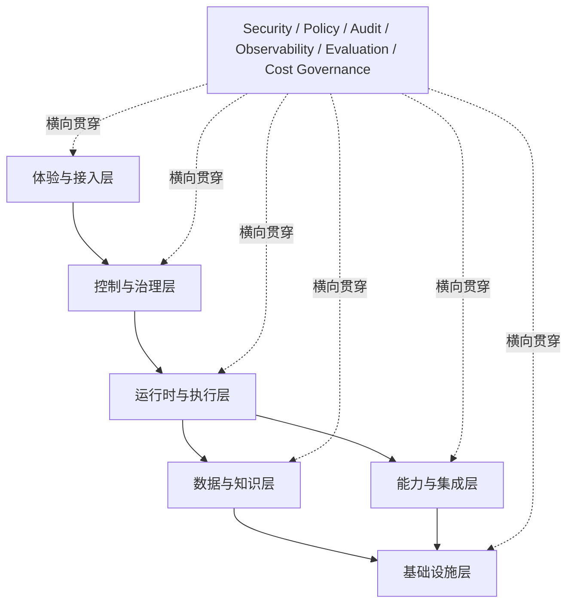

# 企业级 Agent Operating System 白皮书

*面向 AI 原生企业的治理、执行与扩展平台*

**版本：** 战略重构版
**日期：** 2026-08-06
**文档性质：** 参考平台模型与战略设计白皮书

> 本白皮书描述企业级 Agent Operating System（简称 Agent OS）的概念、能力边界、参考架构、治理模型和演进路径。文中明确区分平台定义、设计判断、参考实现和长期愿景；除非特别说明，内容不代表某一具体产品已经交付的全部能力。

**阅读说明**

本文同时面向企业决策者与技术人员。决策者可以重点阅读执行摘要、企业问题、平台定位、应用场景和路线图；技术读者可以重点阅读总体架构、核心对象、运行时、治理、部署和附录。全文以“治理与执行”为 Agent OS 的核心，不将模型、Workflow、数字员工或 Marketplace 单独包装成互相竞争的产品线。

**目录**

- [第一部分｜1. 执行摘要](#第一部分1-执行摘要)
- [第一部分｜2. 从软件企业到 AI 原生企业](#第一部分2-从软件企业到-ai-原生企业)
- [第一部分｜3. 企业级 Agent 面临的新问题](#第一部分3-企业级-agent-面临的新问题)
- [第一部分｜4. Agent OS 的定义、价值与边界](#第一部分4-agent-os-的定义价值与边界)
- [第一部分｜5. Agent OS 与现有平台的关系](#第一部分5-agent-os-与现有平台的关系)
- [第二部分｜6. Agent OS 的设计原则](#第二部分6-agent-os-的设计原则)
- [第二部分｜7. 总体参考架构](#第二部分7-总体参考架构)
- [第二部分｜8. 控制与治理层](#第二部分8-控制与治理层)
- [第二部分｜9. 运行时与执行层](#第二部分9-运行时与执行层)
- [第二部分｜10. 数据与知识层](#第二部分10-数据与知识层)
- [第二部分｜11. 能力扩展层](#第二部分11-能力扩展层)
- [第三部分｜12. 安全与治理模型](#第三部分12-安全与治理模型)
- [第三部分｜13. 审计、可观测性、成本控制与 Evaluation](#第三部分13-审计可观测性成本控制与-evaluation)
- [第三部分｜14. 多租户、部署模式与运维体系](#第三部分14-多租户部署模式与运维体系)
- [第三部分｜15. 人机协作、审批与责任边界](#第三部分15-人机协作审批与责任边界)
- [第四部分｜16. 企业应用场景](#第四部分16-企业应用场景)
- [第四部分｜17. 平台建设路线图与成熟度模型](#第四部分17-平台建设路线图与成熟度模型)
- [第四部分｜18. 开发者、合作伙伴与生态体系](#第四部分18-开发者合作伙伴与生态体系)
- [第四部分｜19. 长期愿景：从 Agent OS 到 AI 原生企业操作系统](#第四部分19-长期愿景从-agent-os-到-ai-原生企业操作系统)
- [附录 A｜术语表](#附录-a术语表)
- [附录 B｜核心资源对象模型](#附录-b核心资源对象模型)
- [附录 C｜Agent 生命周期示例](#附录-cagent-生命周期示例)
- [附录 D｜端到端业务执行示例](#附录-d端到端业务执行示例)
- [附录 E｜安全威胁与控制项](#附录-e安全威胁与控制项)
- [附录 F｜能力成熟度与阶段验收标准](#附录-f能力成熟度与阶段验收标准)

## 第一部分｜1. 执行摘要

### 1.1 核心判断

企业正在从“人使用软件完成工作”走向“人和 AI Agent 共同完成工作”。模型 API 和 Agent Framework 已经降低了智能应用的开发门槛，但企业真正面临的难题并不是如何让一个 Agent 完成一次演示，而是如何让成百上千个 Agent 在真实组织中被识别、被授权、被部署、被监控、被评估和被追责。

Agent OS 的核心价值，是为 Agent 提供一层面向企业生产环境的治理与执行基础设施。它连接基础模型、企业知识、业务系统和人的组织关系，负责管理 Agent 的身份、能力、上下文、任务、权限、生命周期和运行结果。

Agent OS 不是一个新的模型，也不是简单的聊天界面。它更接近企业中的“智能执行操作系统”：模型提供推理能力，业务系统提供业务事实，工具和连接器提供行动入口，而 Agent OS 负责把这些能力组织成可控、可观察、可恢复的业务执行过程。

### 1.2 企业为什么需要这一层

传统企业软件擅长记录数据和执行确定性规则；云平台擅长规模化交付软件；Agent 则开始处理包含理解、判断、规划和协作的不确定任务。随着 Agent 进入生产环境，新的平台问题会集中出现：

| 企业问题 | 需要的平台能力 |
|---|---|
| 不知道 Agent 是谁、由谁负责 | 人、Agent、服务和工作负载身份 |
| 不知道 Agent 可以做什么 | 权限、策略、风险分级和审批 |
| Agent 执行失败后无法恢复 | 状态、重试、超时、检查点和补偿 |
| Agent 使用了错误或越权的数据 | 知识治理、权限过滤和上下文边界 |
| Agent 变多后难以管理 | 注册、版本、生命周期和资产目录 |
| 模型或 Prompt 变化后质量不可控 | Evaluation、回归测试、晋级和回滚 |
| 成本、延迟和责任无法解释 | 观测、成本治理、审计和责任链 |

### 1.3 Agent OS 的核心能力

本白皮书将 Agent OS 归纳为六类核心能力：

1. **身份与控制：** 管理租户、组织、用户、Agent、服务身份和资源所有权。
2. **智能运行时：** 负责上下文、规划、工具选择、推理和多 Agent 协作。
3. **可靠执行：** 负责任务、Workflow、状态、调度、重试、审批和恢复。
4. **数据与知识：** 管理企业知识、记忆、上下文和执行产物。
5. **能力扩展：** 通过 Skill、Tool、Plugin、Connector 和 MCP 连接外部能力。
6. **企业治理：** 提供 Policy、Secret、Audit、Observability、Evaluation 和 Cost Governance。

### 1.4 价值与边界

对企业而言，Agent OS 的直接价值不是增加一个聊天入口，而是把 Agent 从一次性实验转化为可运营的企业资产：有明确的所有者，有可审计的行为，有可配置的风险边界，有可恢复的执行状态，也有持续评估和迭代机制。

Agent OS 的早期建设不应承诺自研基础模型、一次性覆盖所有业务流程、直接建设公共 Marketplace 或马上实现跨组织 Federation。平台应先建立治理、运行时、执行和运营的内核，再逐步开放扩展和生态能力。

### 1.5 结论

企业级 Agent 的竞争重点将从“谁能更快做出一个 Agent”逐渐转向“谁能更可靠地管理一组 Agent”。Agent OS 解决的正是从单个 Agent 到企业级 Agent 体系之间的缺口：让智能能够被组织、被执行、被治理并产生可持续的业务价值。

## 第一部分｜2. 从软件企业到 AI 原生企业

### 2.1 企业技术形态的三次变化

企业信息化的主线，是不断把生产方式抽象、数字化并交给更高层次的系统管理。过去几十年可以用三个阶段概括：

```text
软件企业
  软件记录和标准化业务
          ↓
云企业
  云平台规模化交付软件
          ↓
AI 原生企业
  Human + Agent 共同执行业务
```

这不是绝对替代关系。AI 原生企业仍然需要业务应用、数据库、云基础设施和人工组织；变化在于，软件系统开始拥有更强的理解和行动能力，企业的执行主体不再只有人。

### 2.2 软件企业：把业务数字化

传统软件企业的核心任务，是把线下的信息、流程和规则变成可记录、可查询、可复用的系统。ERP、CRM、HR、SCM、MES 和协同系统解决了三类问题：

- **信息记录：** 将客户、订单、财务、员工和生产数据集中到系统中。
- **流程标准化：** 用明确规则处理申请、审批、采购、交付和结算。
- **数据集中化：** 让组织在相对统一的数据基础上开展协作。

这类系统的优势是确定性。给定输入和规则，系统可以重复执行相同的流程；但现实企业中仍存在大量需要理解、判断、协调和创造的工作，例如分析客户意图、总结行业变化、制定方案和处理例外情况。

### 2.3 云企业：把软件规模化

云计算改变了软件的交付和运维方式。企业不必为每一个应用单独准备完整基础设施，而是通过云计算、容器、托管数据库、消息系统和 API 组合业务能力。

云企业的关键变化包括：

- 基础设施被抽象为可编程资源；
- 应用通过 API 连接，形成更大的服务网络；
- 软件从年度发布转向持续交付；
- 平台能力逐渐成为企业的核心资产。

云平台解决的是规模、速度和连接问题，但云应用仍然主要是“被人使用的工具”。系统可以记录销售和财务工作，却不一定能够主动理解目标、安排步骤、调用多个系统并对结果负责。

### 2.4 AI 原生企业：把部分执行交给 Agent

AI 原生企业的关键变化，不是企业使用了某个 AI 工具，而是企业的核心能力由 Human + Agent 共同构成。人负责目标、价值判断、复杂决策和责任承担；Agent 在明确边界内负责检索、分析、规划、执行和反馈。

```text
过去：人 → 应用 → 数据

现在：人 + Agent → Agent OS → 企业系统与数据
```

Agent 与传统软件的差异可以概括为：

| 维度 | 传统软件 | Agent |
|---|---|---|
| 输入 | 指令、表单或固定事件 | 目标、问题或上下文 |
| 执行 | 预先定义的规则 | 动态规划与工具调用 |
| 能力 | 功能模块 | Skill、Tool 和知识 |
| 状态 | 业务数据和配置 | 任务状态、记忆和执行上下文 |
| 权限 | 用户和服务账号 | 用户、Agent、服务和工作负载身份 |
| 生命周期 | 发布、升级、下线 | 创建、评估、审批、部署、运营和退休 |

### 2.5 Agent 成为新的企业执行单元

在工业时代，机器是重要的生产单元；在软件时代，应用和服务成为重要的生产单元；在 AI 时代，Agent 开始成为处理认知型和协同型工作的执行单元。

Agent 并不意味着把企业变成无人组织。它意味着企业需要像管理应用、服务和员工一样管理一类新的数字执行实体：明确它的职责，授予必要能力，限制风险边界，观察执行质量，并在需要时由人接管。

### 2.6 Agent 组织的出现

未来的企业组织将同时包含人的组织和 Agent 的组织。以市场部门为例，人的团队负责策略、品牌和关键关系；市场研究 Agent、内容 Agent、活动 Agent 和分析 Agent 可以围绕同一目标协作。

```text
企业目标
   ↓
人的组织：策略、判断、关系和责任
   +
Agent 组织：检索、分析、生成、执行和反馈
   ↓
Agent OS：身份、权限、协作、生命周期和运营
```

Agent OS 的作用不是替代组织设计，而是为这种混合组织提供统一的运行规则。

### 2.7 为什么 Agent 需要操作系统

当企业只有少量实验性 Agent 时，单个 SDK 或应用框架可能已经够用；当 Agent 进入多个部门、连接多个业务系统并持续执行任务时，以下问题将不再能够靠 Prompt 或脚本解决：

- **身份：** 谁创建、谁拥有、谁运行和谁对结果负责？
- **权限：** Agent 能读取哪些数据、调用哪些工具、执行哪些动作？
- **协作：** 多个 Agent 如何分工、传递状态和避免循环？
- **生命周期：** 如何评估、发布、升级、回滚和退休？
- **运营：** 如何发现失败、控制成本、解释延迟和处理事故？
- **治理：** 如何满足审计、合规、数据边界和人工控制要求？

这些问题与传统操作系统管理应用、进程、资源和权限具有相似性，但对象已经从软件进程扩展为能够理解和行动的 Agent。

## 第一部分｜3. 企业级 Agent 面临的新问题

### 3.1 从演示可用到生产可依赖

一个 Agent 能够完成一次对话，不代表它可以承担企业工作。企业生产环境关心的不是单次回答是否流畅，而是任务是否在正确权限下完成、失败是否能够恢复、结果是否可验证，以及出现问题时是否能够定位责任。

Agent 的不确定性主要来自三个方面：模型输出具有概率性；外部工具和业务系统具有状态；企业数据和权限具有边界。平台必须把这三类不确定性包裹在可控制的执行机制内。

### 3.2 六类基础管理问题

#### 身份问题：Agent 是谁

Agent 不能只是一个 Prompt 字符串。它需要有稳定的身份、所有者、所属组织、版本、信任级别和生命周期状态。一次执行还需要关联发起用户、使用的 Agent 和实际工作负载。

#### 权限问题：Agent 能做什么

登录用户拥有权限，不等于该用户启动的 Agent 可以无限继承权限。Agent 需要独立的能力授权和数据边界，策略还应根据资源类型、操作类型、环境、时间、风险和审批状态进行判断。

#### 执行问题：Agent 如何可靠完成

Agent 可能选择错误工具、重复调用、超时、遇到外部系统异常或在长任务中丢失上下文。因此任务需要状态机、超时、重试、检查点、补偿、取消和人工接管。

#### 知识问题：Agent 知道什么

企业知识分布在文档、数据库、业务系统、邮件、会议和人的经验中。知识需要来源、版本、权限、有效期和质量标记。记忆也不能无限累积，必须支持验证、过期和删除。

#### 生命周期问题：Agent 如何变化

Prompt、模型、知识、工具和 Workflow 的任意变化，都可能改变 Agent 的行为。企业需要把开发、测试、评估、审批、发布、运营、回滚和退休连接成一个生命周期。

#### 责任问题：谁对结果负责

Agent 不是责任主体。企业需要知道谁批准了它的权限，谁拥有它，谁运营它，谁审批了高风险动作，以及哪些系统和数据影响了最终结果。没有审计和责任链，自动化的规模越大，组织风险越高。

### 3.3 Agent Framework 解决不了全部问题

Agent Framework 通常擅长提供模型调用、工具调用、Prompt 管理、状态编排和开发接口，是构建 Agent 的重要基础。但框架与企业平台的关注点不同：

| 关注点 | Agent Framework | 企业级 Agent OS |
|---|---|---|
| 核心目标 | 创建和运行 Agent | 管理 Agent 资产与企业执行 |
| 身份 | 通常由应用自行处理 | 平台级身份、所有权和责任链 |
| 权限 | 工具级或应用级配置 | 组织、数据、工具、模型和风险策略 |
| 生命周期 | 代码发布 | 评估、审批、部署、运营和退休 |
| 失败处理 | 由应用实现 | 统一任务状态、恢复和人工介入 |
| 运营 | 日志和指标可选 | 审计、成本、质量和风险默认存在 |

二者不是互相替代的关系。Agent OS 可以承载多个框架和运行时，但需要为它们提供统一的治理与运营边界。

### 3.4 企业需要的不是更多 Feature，而是平台能力

企业平台的价值来自可复用、可组合、可治理的能力，而不是功能名称的数量。Agent OS 的建设顺序应当围绕以下能力展开：

```text
基础治理
   ↓
Agent Runtime
   ↓
可靠执行
   ↓
评估与运营
   ↓
扩展与生态
```

这也是本白皮书采用能力成熟度路线，而不是按功能编号堆叠版本的原因。

## 第一部分｜4. Agent OS 的定义、价值与边界

### 4.1 定义

Agent Operating System 是面向企业级 AI Agent 的治理与执行平台。它位于基础模型、企业数据、业务应用和基础设施之间，为 Agent 提供统一的身份、能力、上下文、执行、状态、生命周期和治理机制。

可以用下面的关系理解其位置：

```text
人和业务组织
        ↓
体验与接入
        ↓
Agent OS
  身份 · 策略 · 运行时 · 执行 · 知识 · 能力 · 运营
        ↓
模型 · 数据 · 业务系统 · 基础设施
```

### 4.2 价值主张

#### 让 Agent 可管理

每个 Agent 都有明确身份、所有者、版本、能力清单和生命周期状态，企业能够建立 Agent 资产目录而不是依赖分散的脚本和配置。

#### 让 Agent 可执行

Agent 的动态判断与确定性执行分离。模型可以规划路径，执行引擎负责状态、可靠性和恢复，业务系统通过受控工具提供行动能力。

#### 让 Agent 可治理

权限、数据、模型、网络、成本和风险都可以通过 Policy 表达，并在规划、调用和提交结果的关键节点执行。

#### 让 Agent 可改进

通过日志、指标、Trace、Dataset、Evaluation 和版本晋级，企业可以判断 Agent 是否变好、变差或偏离业务目标。

#### 让 Agent 可扩展

通过 Skill、Tool、Plugin、Connector 和 SDK，组织可以复用能力，并在安全、版本和兼容性边界内建立内部与外部生态。

### 4.3 核心边界

Agent OS 的核心对象是 Agent 及其企业执行环境，而不是所有 AI 能力的总和。以下能力可以接入 Agent OS，但不应被混淆为 Agent OS 本身：

- 模型供应商提供模型推理能力；
- 数据平台提供数据存储、处理和治理能力；
- 业务系统提供订单、客户、财务和生产等领域事实；
- Agent Framework 提供开发抽象和运行组件；
- Workflow 系统提供确定性流程编排；
- SaaS 应用提供特定业务功能。

Agent OS 的差异在于，它把这些能力组织到同一个可治理的 Agent 执行体系中。

### 4.4 非目标

Agent OS 早期建设不以以下事项为目标：

- 训练或替代所有基础模型；
- 将每一个业务流程都转换为全自动 Agent；
- 以“数字员工”概念替代平台对象模型；
- 在缺少用户、内容和安全审核的情况下建设公共 Marketplace；
- 在跨组织身份、信任、责任和结算机制尚未成熟时承诺 Federation；
- 通过完全自主执行绕过企业的权限、审批和责任制度。

## 第一部分｜5. Agent OS 与现有平台的关系

### 5.1 企业 AI 技术栈中的位置

企业 AI 技术栈可以分为若干层：

```text
体验与业务应用
        ↓
Agent OS：治理、运行和执行
        ↓
Agent Framework 与模型服务
        ↓
企业数据与业务系统
        ↓
云基础设施与安全基础设施
```

这不是严格的线性依赖关系。Agent OS 会通过 API、事件、连接器和知识接口与多个系统交互，但它提供了一个企业级的控制边界和执行上下文。

### 5.2 与模型平台的关系

模型平台关注模型训练、推理、托管、路由、版本和成本。Agent OS 使用模型能力，但还需要处理身份、知识权限、工具调用、任务状态、审批和责任链。

二者之间应通过 Model Gateway 或统一模型接口解耦，使企业能够根据任务、风险、成本和性能选择不同模型，而不会把 Agent 逻辑绑定在单一提供商上。

### 5.3 与 Agent Framework 的关系

Agent Framework 是开发者构建智能行为的重要工具。Agent OS 可以支持多个框架或自研运行时，要求它们通过统一的 Agent、Task、Run、Tool、Policy 和 Audit 接口接入平台。

这种关系类似应用框架与操作系统的关系：框架帮助开发，操作系统负责资源、权限、运行和治理。

### 5.4 与 Workflow 或 BPM 平台的关系

Workflow 擅长确定性编排、事件触发、审批、调度和重试；Agent 擅长目标理解、动态规划和非结构化判断。两者应当组合，而不是互相取代：

```text
Workflow：确定性步骤、状态和边界
Agent：目标理解、判断和动态计划
Execution Engine：可靠执行、恢复和审计
```

Agent OS 可以调用已有 Workflow 引擎，也可以在逐步成熟后提供自己的编排能力。早期不应为了完整产品版图而过早建设通用 Workflow 基础设施。

### 5.5 与数字员工产品的关系

数字员工是面向业务用户的角色表达，例如客服 Agent、销售 Agent 或财务 Agent。它们可以作为 Agent 模板、解决方案或应用层对象存在，但不应取代底层平台对身份、能力、策略、知识、执行和生命周期的统一管理。

### 5.6 与 Marketplace 的关系

Marketplace 是生态分发机制，不是平台内核。平台应先建立官方能力库和企业内部目录，再根据安全审核、版本管理、兼容性、开发者激励和用户需求逐步开放合作伙伴和公共分发。

### 5.7 定位总结

Agent OS 的战略定位可以概括为：

> 让企业能够在可治理、可观察、可恢复和可评估的边界内，规模化地创建、运行和管理 AI Agent。

## 第二部分｜6. Agent OS 的设计原则

### 6.1 智能与执行分离

模型擅长理解目标、生成计划和做出概率性判断；企业执行需要状态、权限、重试、超时、审批和审计。Agent OS 将二者分离：模型负责智能决策，运行时负责把决策转化为计划，执行引擎负责在受控环境中完成动作。

这种分离带来两个好处：一是可以替换模型而不改变业务执行边界；二是可以让同一个执行引擎承载不同模型、不同 Agent Framework 和不同业务场景。

### 6.2 声明与运行分离

Agent、Skill、Tool、Workflow、Policy 和 Knowledge 都是可注册、可版本化的声明性资源；Task、Run、Approval、Artifact 和 Event 是运行过程中的实例资源。定义变更不能直接覆盖历史运行，运行记录也不能反向修改资源定义。

```text
资源定义：Agent / Skill / Tool / Workflow / Policy / Knowledge
                       ↓ 发布与绑定
运行实例：Task / Run / Approval / Artifact / Event
```

### 6.3 默认可治理

治理不应作为部署后的附加模块，而应内置于 Agent 的创建、发布、调用和运行流程。没有身份的 Agent 不应进入生产；没有策略的工具不应被调用；没有审计上下文的执行不应成为不可解释的黑箱。

### 6.4 一切皆资源

平台中的实体应当具备统一的资源语义：名称、标识、所有者、版本、状态、依赖、权限、审计和生命周期。这样可以用同一套控制方式管理 Agent、工具、知识库、策略和执行产物，避免每个模块形成独立的管理孤岛。

### 6.5 用确定性边界包裹不确定性

Agent 的计划和推理可以是不确定的，但以下边界必须是确定的：可访问的数据、可调用的工具、可消耗的预算、可接受的风险、可恢复的状态和可追踪的结果。

### 6.6 模型与提供商中立

模型能力持续变化，企业也可能同时使用公有云模型、私有模型、开源模型和领域模型。Agent OS 应通过统一模型接口、Provider Registry 和 Model Gateway 解耦模型选择与 Agent 业务逻辑，并根据任务、风险、成本和延迟进行路由。

### 6.7 失败可恢复

可靠性不是“模型永远正确”，而是错误发生后系统仍然有办法控制影响。长任务必须具备状态持久化；外部调用必须具备超时和重试策略；不可逆操作必须有审批或补偿路径；无法自动恢复时必须支持人工接管。

### 6.8 评估贯穿生命周期

Agent 的质量不是一次测试决定的。Prompt、模型、知识、Skill、Tool、Workflow 和 Policy 的任意变化，都可能导致准确性、可靠性、安全性、成本或延迟变化。因此评估必须贯穿设计、发布、运行和变更阶段。

## 第二部分｜7. 总体参考架构

### 7.1 六层架构

Agent OS 采用“六层架构 + 横向治理能力”。六层按职责分离，但不要求每一层都由独立产品或独立服务实现。



### 7.2 体验与接入层

体验与接入层面向人、系统和开发者提供入口，包括 Web 控制台、企业 IM、API、CLI、SDK、Webhook 和外部系统嵌入。

该层负责请求接收、用户体验、结果呈现和基础会话管理，但不应把权限判断、业务执行或审计逻辑只放在前端。任何来自接入层的请求都必须进入统一的身份解析、策略检查和运行时流程。

### 7.3 控制与治理层

控制与治理层管理 Agent OS 的资源和规则，包括租户、组织、身份、Agent Registry、版本、Policy、Secret、配额、生命周期和环境。

它是平台的控制面：负责声明“谁拥有何种资源、何种资源可以在什么边界内运行”，而不是直接执行每一个业务动作。

### 7.4 运行时与执行层

运行时与执行层负责“如何理解目标、如何形成计划以及如何可靠完成”。它包含输入处理、上下文组装、规划、推理、能力解析、Task、Run、Workflow、调度、状态、重试、审批和人工介入。

### 7.5 数据与知识层

数据与知识层负责 Agent 的事实来源和执行上下文，包括企业知识、业务数据、短期记忆、长期记忆、组织记忆、检索索引、上下文以及 Artifact。

数据访问必须同时满足检索相关性和权限约束。知识库返回的内容不应绕过组织、租户和资源级权限。

### 7.6 能力与集成层

能力与集成层负责 Agent 的行动边界，包括 Skill、Tool、Plugin、Connector 和 MCP Server。它把外部系统的 API、数据库、文件、浏览器、消息系统和业务操作包装为可声明、可授权、可观察的能力。

### 7.7 基础设施层

基础设施层提供模型网关、计算、沙箱、数据库、对象存储、事件基础设施、API Gateway、容器、网络、日志和监控。它为上层提供可用性和资源隔离，但不应把业务策略隐藏在基础设施配置中。

### 7.8 横向治理能力

以下能力横向贯穿所有层：

| 横向能力 | 作用 |
|---|---|
| Security | 保护身份、数据、网络、运行环境和供应链 |
| Policy | 表达并执行身份、数据、工具、模型、风险和成本约束 |
| Audit | 记录可复盘的执行事实和责任链 |
| Observability | 观察日志、指标、Trace、状态、延迟和资源使用 |
| Evaluation | 评估 Agent 的质量、可靠性、安全性和回归风险 |
| Cost Governance | 管理模型、计算、存储、工具和部门级成本 |

## 第二部分｜8. 控制与治理层

### 8.1 控制层的职责

控制与治理层回答四个基本问题：

1. 平台中有哪些资源？
2. 每个资源由谁拥有和管理？
3. 每个资源在什么条件下可以被使用？
4. 资源如何创建、变更、发布、暂停和退休？

它不应成为一个只有管理后台的目录，而应成为所有 Agent 运行时都依赖的治理内核。

### 8.2 租户、组织、工作区与环境

企业级平台至少需要区分以下边界：

- **Tenant：** 平台级资源和计费隔离单元；
- **Organization：** 企业或组织结构，用于所有权、部门和责任管理；
- **Workspace：** 面向团队的协作空间，用于开发、知识和能力复用；
- **Environment：** 开发、测试、预发布和生产等运行环境。

同一企业可以有多个工作区和环境，但生产资源不能默认继承开发资源的权限和密钥。

### 8.3 身份模型

平台区分四类身份：

| 身份 | 说明 |
|---|---|
| Human Identity | 真实用户和责任主体 |
| Agent Identity | Agent 的独立身份、所有者和信任级别 |
| Service Identity | 代表系统或服务调用平台的身份 |
| Workload Identity | 某次 Run、Task 或工作负载的运行身份 |

用户可以发起 Agent，但 Agent 不应只是用户 Token 的别名。平台需要把用户授权、Agent 授权和具体运行授权分别记录，以便在权限收缩、人员离职或 Agent 版本变更时进行审查。

### 8.4 Agent Registry

Agent Registry 是 Agent 的清单和控制入口，至少包含：

- Agent 标识、名称、描述和业务目标；
- 所属组织、所有者和运营团队；
- 版本、状态和依赖；
- 使用的模型、Prompt、Knowledge、Skill 和 Tool；
- 允许的环境、数据域、网络和预算；
- 风险等级、审批要求和生命周期状态；
- 最近评估、发布、失败和回滚记录。

Registry 的作用不是把 Agent 变成静态配置，而是让平台能够发现、比较、授权和运营 Agent 资产。

### 8.5 Policy Registry 与策略绑定

Policy 是可版本化的约束资源。策略可以绑定到租户、组织、用户、Agent、Tool、Knowledge、Environment 或 Workflow，并在运行时根据上下文组合生效。

策略域包括：

- 身份策略：谁可以创建、运行、管理和审批；
- 数据策略：可访问的数据分类、范围、字段和租户；
- 工具策略：可调用的工具、参数和操作；
- 执行策略：是否需要审批、是否允许重试和是否允许外部网络；
- 模型策略：允许的提供商、模型、区域和成本范围；
- 风险策略：不同动作对应的风险级别和人工控制；
- 成本策略：Token、调用、计算、存储和部门预算；
- 留存策略：日志、Artifact、知识和记忆的保存期限。

### 8.6 Secret 与凭证管理

API Key、OAuth Token、数据库密码、证书和 SSH 凭证不应写入 Agent Prompt、Workflow 文件、Plugin 包或普通日志。Secret Manager 应支持：

- 按租户、环境和连接器隔离；
- 最小权限和短期凭证；
- 轮换、吊销和过期；
- 运行时注入而非静态复制；
- 使用记录和异常访问审计。

Agent 只能获得完成当前任务所需的最小凭证，并且不能通过普通输出泄露凭证内容。

### 8.7 生命周期控制

Agent 的生命周期至少包括 Draft、Design、Sandbox、Evaluation、Approval、Published、Deployed、Operating、Suspended 和 Retired。

状态迁移应具备条件和责任人。例如，Draft 不能直接进入生产；生产版本发生模型或权限变化时，应重新评估；Retired 之后需要保留必要审计记录，但停止新的业务执行。

### 8.8 配额与资源治理

控制层可以按租户、组织、Agent、用户或 Workflow 配置：

- 模型和 Token 预算；
- 工具调用次数和并发；
- 运行时长与队列优先级；
- 存储、Artifact 和知识索引容量；
- 外部网络和浏览器使用额度；
- 高风险动作的每日或每次审批上限。

配额不是可靠性的替代品，但可以防止异常循环、失控调用和成本意外扩张。

## 第二部分｜9. 运行时与执行层

### 9.1 运行时职责

运行时把一次业务请求转化为可治理的执行过程。它不只负责调用模型，还要管理输入、上下文、能力、计划、状态、结果和中间事件。

```text
请求
  ↓
输入解析与身份绑定
  ↓
上下文组装
  ↓
目标理解与计划
  ↓
能力解析与策略检查
  ↓
任务执行与状态持久化
  ↓
结果、Artifact、审计与评估
```

### 9.2 Agent 与 Workflow 的边界

Agent 负责理解目标和做出决策；Workflow 负责确定性编排；Execution Engine 负责可靠执行；Human-in-the-loop 负责高风险环节的人工控制。

Agent 可以在运行时提出动态计划，但计划中的外部动作必须通过能力注册和 Policy 检查。Workflow 可以提供固定顺序、条件分支、并行、事件触发和审批节点，但不应把复杂的认知判断隐藏成无法观测的脚本。

### 9.3 上下文组装

Context Manager 将多个来源组装成当前 Run 可使用的上下文：

- 用户请求和会话上下文；
- 租户、组织、角色和权限；
- Agent 目标、约束和输出格式；
- 业务系统状态；
- Knowledge 检索结果；
- 相关 Memory；
- 当前 Task、Workflow 和历史步骤；
- 可用模型、Tool、Skill 和预算。

上下文组装必须受到数据策略和 Token 预算约束，不能通过“把更多内容塞进 Prompt”替代检索、权限和摘要机制。

### 9.4 规划与推理

Planning Engine 根据目标、约束和可用能力生成执行计划。规划结果至少要能表达目标、步骤、依赖、输入、预期输出、风险和人工控制点。

Reasoning Engine 可以执行分析、反思和自我修正，但平台应将可审计的决策摘要、工具调用和结果保存在运行记录中，不要求把不可控的内部思维过程作为企业审计格式。

### 9.5 能力解析

Capability Resolver 根据任务、Agent 配置、Policy、环境和上下文选择可用能力。解析过程要回答：

- 这个能力是否允许当前 Agent 使用？
- 能力版本是否与 Agent 兼容？
- 参数是否满足输入约束？
- 当前风险是否需要审批？
- 调用是否超过配额或预算？
- 外部系统是否可用且处于正确环境？

能力解析失败时应返回可解释的拒绝或升级结果，而不是让模型反复猜测工具名称。

### 9.6 Execution Engine

Execution Engine 将计划转换为可追踪的 Task 和 Run，负责：

- 创建和调度任务；
- 持久化运行状态；
- 执行顺序、并行和依赖；
- 超时、取消和重试；
- 检查点和恢复；
- 补偿和人工接管；
- 记录事件、指标、成本和审计。

执行引擎应将每一次外部调用视为有状态动作，而不是简单的函数调用。

### 9.7 Workflow 能力

Workflow 适合表达确定性或半确定性的业务流程，包括顺序步骤、并行分支、条件分支、事件触发、定时调度、人工审批和异常处理。

Workflow 不应取代 Agent 的目标理解和动态判断，也不应允许 Skill 内部隐藏复杂 DAG。Skill 保持能力边界，Workflow 负责跨能力编排，二者通过明确输入、输出和版本依赖连接。

### 9.8 运行状态与可靠性

一个 Run 至少应经历以下状态：

```text
Created → Queued → Running → Waiting → Succeeded
                         ↘ Failed / Cancelled / TimedOut
```

其中 Waiting 可以代表等待外部事件、人工审批、资源或重试时间。状态转换必须幂等，重复消息不能导致同一业务动作被无意执行多次。

### 9.9 人工介入

人工介入不是异常补丁，而是企业 Agent 体系的正常控制模式。平台应支持：

- 执行前审批；
- 条件审批；
- 结果复核；
- 风险升级；
- 暂停、修改、拒绝、重试和人工接管。

审批界面应展示目标、数据来源、拟执行动作、风险、影响范围、预期成本和可回滚性，使审批者能够基于足够上下文做出判断。

### 9.10 多 Agent 协作

多 Agent 协作应以明确角色、输入输出、权限和责任边界为前提。协调 Agent 可以分派任务，但不能自动继承所有子 Agent 的权限；子任务的结果应保留来源、版本和状态，避免形成不可解释的“Agent 黑箱网络”。

## 第二部分｜10. 数据与知识层

### 10.1 四类数据对象

Agent OS 明确区分 Knowledge、Memory、Context 和 Artifact：

| 对象 | 定义 | 典型生命周期 |
|---|---|---|
| Knowledge | 企业可复用的事实、规则和文档内容 | 摄取、处理、索引、更新、过期 |
| Memory | 交互或执行形成的状态、偏好和经验 | 产生、验证、引用、修正、删除 |
| Context | 当前 Run 可使用的信息集合 | 组装、使用、压缩、销毁 |
| Artifact | 一次执行产生的文件或交付物 | 生成、存储、分享、归档、删除 |

把四者分开，有助于避免将聊天历史误当成可靠知识，也避免把每个输出都永久写入组织记忆。

### 10.2 Knowledge Pipeline

企业知识系统需要完整流水线：

```text
来源接入
  ↓
解析与清洗
  ↓
分类、脱敏与权限标记
  ↓
切分、索引与版本化
  ↓
检索与重排序
  ↓
权限过滤与上下文组装
  ↓
引用、反馈与质量评估
```

来源可以包括文档、业务系统、数据库、通信记录、API、文件和经过授权的人类知识。系统应保留来源、更新时间、所有者、分类、有效期和访问策略。

### 10.3 检索与权限

企业检索不能只以语义相似度为目标。Retrieval Engine 应综合：

- 语义检索；
- 关键词检索；
- 元数据过滤；
- 租户和组织过滤；
- 用户、Agent 和资源权限过滤；
- 当前业务上下文；
- 来源可信度、时效性和版本。

权限过滤必须在检索过程和上下文组装过程都存在，不能先把越权数据检索出来，再希望模型自行忽略。

### 10.4 Memory 管理

Memory 可以分为：

- **短期记忆：** 当前会话或当前 Task 的中间状态；
- **长期记忆：** 经验证后可复用的用户或 Agent 经验；
- **组织记忆：** 经授权沉淀为团队或企业资产的知识和经验。

记忆写入应具备来源、置信度、所有者、有效期和删除机制。涉及个人偏好、敏感信息或决策依据的记忆，需要更严格的同意、访问和留存策略。

### 10.5 Context Assembly

Context Assembly 根据任务组装最小必要上下文，而不是无差别拼接全部历史。组装器需要考虑 Token 预算、信息优先级、权限、来源可信度、版本和上下文冲突。

当知识或记忆之间存在冲突时，系统应保留冲突信号并要求 Agent 或人工确认，而不是用排序结果掩盖事实不确定性。

### 10.6 Artifact Store

Agent 的结果不只有文本，还可能是 PDF、Excel、图片、PPT、CSV、代码、报表和结构化事件。Artifact Store 应提供：

- 统一类型和元数据；
- 所属 Task、Run、Agent 和用户；
- 版本、预览、下载和分享；
- 权限、敏感度和保留期限；
- 内容校验、病毒扫描和审计；
- 失败产物清理和生命周期管理。

Artifact 的访问权限不能因为“它是 Agent 生成的”而自动扩大。

### 10.7 数据边界

多租户和跨系统场景需要同时控制租户、组织、数据域、网络、运行环境和模型提供商边界。平台应能明确回答：哪些数据被发送给哪个模型、哪些数据可以离开企业网络、哪些 Artifact 可以对外分享，以及每个边界由哪条 Policy 控制。

## 第二部分｜11. 能力扩展层

### 11.1 能力分类

Agent OS 使用分层能力模型：

| 能力 | 说明 | 示例 |
|---|---|---|
| Skill | 面向目标的原子或业务能力 | 发票识别、客户摘要、风险分析 |
| Tool | 可被调用的具体操作 | 查询订单、发送邮件、创建工单 |
| Plugin | 可安装、可版本化的扩展包 | 一组工具、事件源或运行适配器 |
| Connector | 与外部系统建立连接 | ERP、CRM、数据库、IM、文件系统 |
| MCP Server | 通过标准协议暴露工具和资源 | 外部能力服务或组织内部工具集 |

边界原则是：Skill 描述“能完成什么”，Tool 描述“如何执行”，Workflow 描述“如何编排多个步骤”。

### 11.2 Capability Registry

所有可调用能力都应进入 Registry，包含名称、描述、版本、输入输出 Schema、依赖、风险、权限、来源、兼容性、运行位置和维护者。

Registry 支持发现和解析，但不等于授权。Agent 看到一个 Tool，不代表它可以调用；最终调用仍需经过身份、Policy、参数和环境检查。

### 11.3 Skill 设计

Skill 应保持清晰的输入、输出和责任边界。一个 Skill 可以内部调用多个 Tool，但对外暴露的能力应当能够被评估、版本化和复用。Skill 不应隐藏跨业务系统的复杂流程，否则平台会形成第二套不可治理的 Workflow 系统。

### 11.4 Plugin SDK 与生命周期

可信的扩展生态需要完整开发体验：

- Plugin CLI 和模板；
- 本地运行与测试；
- 输入输出 Schema 校验；
- 权限和 Secret 声明；
- 依赖与兼容性管理；
- 版本发布和回滚；
- 安全扫描和签名；
- 运行指标与故障诊断。

Plugin 生命周期包括开发、测试、审核、发布、安装、升级、暂停和卸载。升级前应检查依赖、权限变化、Evaluation 结果和回滚路径。

### 11.5 安全边界

扩展能力是 Agent 风险的重要来源。平台应提供沙箱、网络限制、文件系统隔离、资源配额、权限清单、依赖扫描、供应链签名和运行时审计。

连接器使用的凭证应由 Secret Manager 管理；插件日志不能输出敏感数据；高风险 Tool 应默认需要更高等级的审批或人工控制。

### 11.6 官方能力库与 Marketplace

生态建设顺序应为：

```text
官方能力库
      ↓
企业内部能力目录
      ↓
合作伙伴生态
      ↓
公共 Marketplace
```

官方能力库解决可用性和示范问题；企业内部目录解决复用、审批和知识沉淀；合作伙伴生态解决行业适配；公共 Marketplace 最终解决跨组织分发。

Marketplace 的治理重点不是上传入口，而是能力真实性、安全性、兼容性、版本、依赖、质量、使用反馈和责任归属。

### 11.7 核心对象模型

Agent OS 将主要资源定义为：

| 对象 | 核心职责 |
|---|---|
| Tenant / Organization | 资源隔离、组织治理和责任边界 |
| Human Identity | 用户身份与责任主体 |
| Agent Identity | Agent 的独立身份、所有者和信任级别 |
| Agent | 面向目标的智能执行主体 |
| Skill | 可复用的原子或业务能力 |
| Tool | 可调用的具体操作 |
| Plugin | 可安装、可版本化的扩展能力包 |
| Connector | 外部系统连接能力 |
| Task | 一次可追踪的业务任务 |
| Workflow | 多步骤、可控制的执行编排 |
| Run | Agent 或 Workflow 的一次运行实例 |
| Knowledge | 可检索、可治理的企业知识 |
| Memory | 交互或执行中形成的状态与经验 |
| Artifact | 执行产生的文件或其他交付物 |
| Policy | 对身份、数据、工具、模型和执行的约束 |
| Evaluation | 对 Agent 行为、质量、成本和可靠性的评估 |

这些对象通过所有权、依赖、授权、版本和运行关系连接。对象模型的目标不是增加抽象，而是让每个可影响业务结果的实体都能够被发现、控制和审计。

### 11.8 标准执行流程

```text
请求进入
  ↓
身份识别与租户解析
  ↓
策略检查与风险判断
  ↓
上下文、知识和记忆组装
  ↓
Agent 规划与能力解析
  ↓
工具 / Skill / Workflow 执行
  ↓
必要时触发人工审批
  ↓
生成结果与 Artifact
  ↓
记录审计、指标、成本和评估数据
```

流程中每一个可能改变外部状态的动作，都必须关联 Agent Identity、Workload Identity、Policy Decision、输入参数、执行结果和审计事件。

## 第三部分｜12. 安全与治理模型

### 12.1 治理目标

Agent OS 的治理目标不是把 Agent 限制成没有自主性的脚本，而是在可控边界内扩大它的执行能力。企业需要形成一条连续的信任链：

```text
可识别 → 可授权 → 可观察 → 可干预 → 可追责 → 可评估
```

任何一个环节缺失，都会让平台在规模化后出现盲区。例如，只有身份没有策略，平台知道谁在调用，却不知道调用是否被允许；只有策略没有审计，平台可以拒绝动作，却不能解释生产事故；只有审计没有评估，平台可以复盘过去，却不能判断下一次变更是否会变差。

### 12.2 身份与零信任执行

每一次 Agent 执行都应经过重新验证，而不是因为某个用户曾经登录过就默认信任所有后续动作。验证上下文至少包括：

- 发起用户和其当前组织关系；
- Agent 身份、版本、所有者和运行环境；
- Workload、Task 和 Run 标识；
- 访问的数据资源和目标系统；
- 使用的 Tool、Skill、Plugin 和模型；
- 当前网络、设备、时间和风险上下文；
- 所需审批和已满足的 Policy 条件。

平台可以采用短期 Token、工作负载身份、双向认证和最小权限原则，但具体实现应根据部署模式和企业现有身份体系选择。

### 12.3 权限模型

RBAC、ABAC 和风险策略各有作用：

- **RBAC：** 表达用户、Agent 或团队的基础角色；
- **ABAC：** 根据资源属性、环境、组织、数据分类和请求上下文判断；
- **风险策略：** 根据操作影响和可逆性决定自动执行、审批或禁止。

三者不应互相替代。角色可以说明“通常负责什么”，属性可以说明“当前条件是否满足”，风险策略可以说明“这个动作是否允许自动发生”。

### 12.4 策略域

策略至少覆盖以下领域：

| 策略域 | 关键问题 |
|---|---|
| 身份策略 | 谁可以创建、运行、管理和审批 Agent？ |
| 数据策略 | Agent 可以访问哪些数据、字段和知识域？ |
| Tool 策略 | Agent 可以调用哪些工具和参数？ |
| 执行策略 | 哪些动作必须暂停或获得人工审批？ |
| 模型策略 | 哪些任务可以使用哪些模型和区域？ |
| 网络策略 | 是否允许访问外部网络、浏览器和特定域名？ |
| 成本策略 | Token、计算、存储和调用预算是多少？ |
| 留存策略 | 日志、Artifact、Memory 和 Knowledge 保留多久？ |

### 12.5 策略执行链

策略应由独立的定义、决策和执行组件组成：

```text
Policy Definition
        ↓
Policy Decision Point
        ↓
Policy Enforcement Point
        ↓
Allow / Deny / Require Approval
        ↓
Audit Event
```

策略至少在三个节点执行：

1. Agent 规划前：判断目标、数据域、模型和总体风险是否允许；
2. Tool 调用前：判断具体参数、目标资源、凭证和审批是否满足；
3. 结果提交前：判断输出、Artifact、外发动作和状态变更是否允许。

策略的拒绝结果应尽量说明缺少的条件、责任人和可行的升级路径，但不能泄露敏感策略细节或内部凭证。

### 12.6 Secret 与数据安全

Secret、Knowledge、Memory 和 Artifact 都是数据安全边界的一部分。平台需要做到：

- 密钥与 Agent 配置分离；
- 敏感数据在进入模型前经过分类和必要的脱敏；
- 模型路由遵守区域、网络和数据驻留要求；
- 连接器只获得最小权限和短期凭证；
- 日志、Trace 和评估数据不默认复制全部业务内容；
- Artifact 分享、下载和外部发送都经过权限检查。

### 12.7 安全运营

安全运营中心应能够发现异常 Token 使用、工具调用爆发、重复失败、越权拒绝、敏感数据外发、插件供应链风险和不符合预期的网络访问。

Agent 的安全治理需要同时关注模型输入、模型输出、工具参数、外部响应和最终业务状态。只检查 Prompt 或只检查输出，都无法覆盖完整执行链。

## 第三部分｜13. 审计、可观测性、成本控制与 Evaluation

### 13.1 审计模型

审计记录的目标是支持复盘、合规、责任认定和故障调查。一次完整的审计事件至少应包含：

- 发起者、Agent Identity 和 Workload Identity；
- Tenant、Organization、Workspace 和 Environment；
- 请求来源、时间、Task、Run 和关联 Workflow；
- 使用的模型、版本、Prompt 或配置版本；
- 使用的 Knowledge、Memory、Skill、Tool 和 Connector；
- 输入、输出、参数摘要和 Artifact 标识；
- Policy Decision、审批链和风险等级；
- 状态变化、错误、重试、延迟、资源和成本；
- 最终结果、人工修改、回滚和责任归属。

审计应记录足够的事实和决策依据，但不把模型内部隐藏思维链作为企业审计的必需格式。对于需要解释的业务结果，应优先提供数据来源、调用记录、规则、策略和可复现输入。

### 13.2 可观测性模型

Agent OS 的可观测性分为四类 Trace：

| Trace | 关注内容 |
|---|---|
| Reasoning Trace | 目标、计划、决策摘要和计划变化 |
| Tool Trace | 工具、参数、响应、重试和错误 |
| Cost Trace | 模型、Token、计算、存储和外部调用成本 |
| Performance Trace | 排队、模型延迟、工具延迟和端到端时长 |

平台还需要记录日志、指标、事件和状态快照，并把它们关联到同一个 Task、Run 和 Agent 版本。这样才能回答“哪里慢、哪里错、谁触发、哪个版本开始变差”。

### 13.3 成本治理

成本治理不只是月末计费，而是运行时约束的一部分。平台应能够按租户、组织、部门、Agent、用户、Workflow、模型和 Tool 查看成本，并支持：

- 预算和配额；
- 预估成本与执行前提示；
- 高成本动作审批；
- 模型路由和降级；
- 异常增长告警；
- 失败重试成本归因；
- 业务结果与成本的关联分析。

成本控制不应简单追求最低价格。企业需要在质量、延迟、合规、可靠性和成本之间做出可解释的策略选择。

### 13.4 Evaluation 的必要性

Agent 的变化来源很多：Prompt、模型、知识、Tool、Workflow、Policy、系统接口和用户行为都可能改变结果。单元测试无法覆盖所有变化，生产日志也无法替代上线前评估。

Evaluation 应将数据集、运行、评分、比较、回归和发布连接起来：

```text
Dataset
   ↓
Evaluation Run
   ↓
Score
   ↓
Compare
   ↓
Regression Check
   ↓
Promote / Reject / Rollback
```

### 13.5 Evaluation 维度

评估指标应根据场景配置，通常包括：

- **正确性：** 结果是否符合业务事实和预期；
- **任务完成率：** 是否完成了目标及必要步骤；
- **工具可靠性：** 是否选择了合适工具、参数和顺序；
- **安全性：** 是否遵守权限、数据和风险策略；
- **可解释性：** 是否能提供来源、执行记录和理由摘要；
- **成本与延迟：** 是否在预算和服务等级内；
- **人工接管率：** 是否频繁进入审批或失败路径；
- **用户反馈：** 结果是否得到接受、修改或拒绝。

指标不应被固定成一个通用分数。不同业务对准确性、速度、成本和风险的权重不同，Evaluation 必须保留原始结果和分项得分。

### 13.6 变更治理

以下变化至少应触发影响分析，必要时触发回归评估：

- Prompt 或系统指令变化；
- 模型、提供商或路由变化；
- Knowledge 来源、切分、索引或权限变化；
- Skill、Tool、Connector 或 Plugin 变化；
- Workflow、审批和 Policy 变化；
- 运行时、沙箱或外部系统接口变化。

发布过程应支持版本晋级、灰度、暂停、回滚和结果对比。高风险 Agent 不应在没有可回滚版本和评估记录的情况下直接替换生产版本。

## 第三部分｜14. 多租户、部署模式与运维体系

### 14.1 多租户隔离

多租户隔离不只是一列 `tenant_id`。至少要考虑：

- 身份和资源目录隔离；
- Knowledge、Memory 和 Artifact 命名空间隔离；
- 运行时和队列隔离；
- Secret 和连接器隔离；
- 网络、模型和数据驻留隔离；
- 日志、Trace、Evaluation 和成本数据隔离；
- 运维人员的跨租户访问审计。

企业客户可以根据风险和合规要求选择逻辑隔离、专属资源、专属网络或独立部署。

### 14.2 部署模式

Agent OS 可以支持多种部署模式：

| 模式 | 适用特征 | 主要关注点 |
|---|---|---|
| Public SaaS | 希望快速使用标准化平台 | 租户隔离、区域、数据和服务等级 |
| Dedicated SaaS | 需要专属资源和更强隔离 | 成本、升级和专属运维 |
| Private Cloud | 数据和系统需要留在企业环境 | 部署、升级、网络和模型接入 |
| Hybrid | 控制面与数据面或运行时分布部署 | 策略同步、连接可靠性和数据边界 |
| Edge | 工厂、门店或离线环境需要本地执行 | 离线能力、同步、资源和安全 |

部署模式不是产品定位本身。无论采用哪种模式，都应保持统一的资源模型、策略语义、审计格式和运行接口。

### 14.3 基础设施与运行安全

基础设施应提供：

- 模型网关和提供商适配；
- Agent、Workflow、Plugin 和事件工作负载的隔离运行；
- 浏览器、代码和文件操作的沙箱；
- 关系数据库、对象存储、向量索引和消息队列；
- API Gateway、身份集成和网络策略；
- 日志、指标、Trace、告警和事故响应；
- 备份、恢复、灾备和版本回滚。

基础设施组件可以使用成熟的云原生技术或托管服务，但平台应保持接口和治理能力的可替换性。

### 14.4 弹性与可用性

Agent 运行负载具有突发性、长尾性和不同模型成本。平台需要区分控制请求、实时交互、长任务、批处理、事件处理和评估任务，并通过队列、优先级、并发限制和资源配额避免互相影响。

可用性设计应明确哪些状态必须持久化、哪些动作必须幂等、哪些失败可以重试、哪些操作只能补偿，以及哪些场景需要人工处理。仅仅增加计算资源不能解决状态和责任问题。

### 14.5 运维中心

平台运维中心至少需要提供：

- Agent inventory：生产 Agent、版本、所有者和状态；
- Runtime dashboard：运行量、成功率、延迟、队列和失败；
- Security dashboard：拒绝、越权、敏感数据和异常调用；
- Cost dashboard：模型、部门、Agent 和 Workflow 成本；
- Evaluation dashboard：版本对比、回归和人工反馈；
- Compliance dashboard：审计覆盖、审批、留存和访问复核。

运维中心的目标是让企业管理 Agent 组合，而不是只查看某一次聊天记录。

## 第三部分｜15. 人机协作、审批与责任边界

### 15.1 人机协作原则

人机协作不是让人负责所有细节，也不是让 Agent 自主绕过组织。合理的分工是：

- 人定义目标、价值、边界和例外原则；
- Agent 处理检索、分析、计划、重复执行和反馈；
- 系统通过 Policy、Workflow 和审批把高风险动作留在可控范围；
- 人在关键决策、不确定性和责任认定处保留干预权。

### 15.2 风险分级

风险分级应依据数据敏感性、操作影响、可逆性、外部影响和责任后果，而不是依据 Agent 是否使用了某个模型。

| 风险级别 | 典型操作 | 控制方式 |
|---|---|---|
| 低风险 | 查询内部知识、生成摘要、整理草稿 | 可自动执行，保留审计 |
| 中风险 | 更新非关键记录、生成内部建议、创建工单 | 条件审批、抽样复核或限额 |
| 高风险 | 对外发送、修改关键业务数据、改变客户状态 | 强制人工审批和结果审计 |
| 极高风险 | 资金、权限、生产系统或法律责任相关操作 | 多人审批、专属流程或禁止自动执行 |

风险等级可以因上下文变化。例如，同一个“发送邮件”动作，在内部草稿和对外正式通知之间具有不同风险。

### 15.3 审批模式

平台支持四类审批：

- **Pre-approval：** 执行前审批，适用于高风险或不可逆动作；
- **Conditional approval：** 满足明确条件时自动执行，其余情况升级；
- **Post-review：** 执行后抽查，适用于可回滚和低风险动作；
- **Escalation：** 超过预算、权限、风险或不确定性阈值时转交人工。

审批请求应展示目标、数据来源、拟执行动作、影响范围、策略判断、预期成本、可回滚性和建议。只展示一句“Agent 建议执行”不足以支撑企业审批。

### 15.4 责任模型

Agent 不是法律责任主体。责任应在企业组织中分解：

| 角色 | 责任 |
|---|---|
| 业务所有者 | 定义目标、业务边界和结果标准 |
| Agent 所有者 | 维护 Agent 配置、能力、知识和版本 |
| 平台运营者 | 维护运行时、策略、资源、监控和事故流程 |
| 安全与合规角色 | 定义风险、数据、审计和访问要求 |
| 审批者 | 对被批准的高风险动作承担审批责任 |
| 执行系统所有者 | 对外部系统状态、接口和结果负责 |

平台的责任是提供身份、策略、审计、评估、干预和恢复机制；企业的责任是决定哪些业务可以自动化、哪些数据可以使用，以及最终由谁授权。

### 15.5 解释与争议处理

当 Agent 结果受到质疑时，平台应能够提供：

- 使用的 Agent、模型和版本；
- 相关知识来源和时间；
- 调用的 Tool、参数和响应；
- 触发的 Policy、审批和人工修改；
- 任务状态、失败、重试和最终结果。

这类“执行解释”比生成一段看似合理的事后说明更可靠，也更适合审计和事故调查。

## 第四部分｜16. 企业应用场景

### 16.1 场景选择原则

Agent OS 不应从“所有工作都可以自动化”开始，而应选择目标清晰、数据边界明确、结果可衡量、失败可控制的业务场景。每个场景都要同时说明价值和风险，不能只展示 Agent 的理想路径。

本章采用统一描述方式：

```text
业务目标
  ↓
Agent 角色
  ↓
知识与工具
  ↓
执行流程
  ↓
审批与风险控制
  ↓
输出产物
  ↓
评估指标
```

### 16.2 客户服务与工单处理

#### 业务目标

缩短客户问题的响应和处理时间，提升知识复用，同时把复杂、敏感或超出授权范围的问题交给人工团队。

#### Agent 角色

客服 Agent 负责理解客户意图、检索经过授权的产品和服务知识、查询订单或工单状态、生成回复草稿，并在满足条件时创建或更新工单。

#### 知识与工具

- 产品文档、服务政策、FAQ 和历史解决方案；
- 客户、订单、物流和工单系统连接器；
- 工单创建、分类、升级和通知 Tool；
- 客户身份、数据域和外发策略。

#### 执行与控制

```text
客户请求
  ↓
身份识别与意图分类
  ↓
知识检索和客户上下文组装
  ↓
生成建议或回复草稿
  ↓
判断是否涉及退款、隐私、投诉或越权
  ↓
自动回复、人工审批或升级工单
```

退款、账户权限、敏感信息和正式对外承诺应采用更高风险等级。Agent 不能因为检索到某个内部文档就绕过客户身份和数据权限。

#### 输出与评估

输出包括回复、工单、引用来源和升级原因。评估关注意图识别、知识引用正确性、一次解决、升级准确性、人工修改率、外发合规和处理时延。

### 16.3 财务分析与合规审查

#### 业务目标

帮助财务团队整理凭证、分析报表、发现异常、准备合规材料和形成审查初稿，但把最终会计判断、资金操作和法律责任保留给授权人员。

#### Agent 角色

财务 Agent 负责从授权数据源收集信息、执行规则和计算、解释异常、生成分析报告，并为人工审查准备证据链。

#### 知识与工具

- 财务数据、发票、合同、报表和政策；
- ERP、费用、支付和文档系统；
- 结构化计算、分类、对账和报告 Tool；
- 数据脱敏、留存、审批和审计 Policy。

#### 执行与控制

Agent 可以自动完成低风险的数据整理和异常分组；涉及支付、账务调整、供应商状态、敏感财务数据或正式申报的动作，必须触发人工审批或专属 Workflow。

#### 输出与评估

输出包括异常清单、分析报告、引用数据、计算过程和待审事项。评估关注数据完整性、规则执行准确性、异常召回、来源可追溯性、人工复核效率和权限合规。

### 16.4 研发与运营协作

#### 业务目标

帮助研发和运营团队处理代码分析、测试生成、故障排查、文档维护、变更准备和运行事件，但不让 Agent 在缺乏审批的情况下直接改变生产系统。

#### Agent 角色

研发 Agent 可以分析代码和 Issue、生成测试或文档；运营 Agent 可以聚合日志和指标、提出故障假设、整理变更方案和运行检查清单。

#### 知识与工具

- 代码仓库、Issue、文档、服务目录和运行手册；
- CI、测试、日志、监控、工单和发布系统；
- 静态分析、查询、测试和变更提案 Tool；
- 分支、环境、审批和生产访问 Policy。

#### 执行与控制

```text
事件或任务进入
  ↓
关联服务、版本、日志和历史事件
  ↓
Agent 形成分析和建议
  ↓
生成测试、Issue 或变更提案
  ↓
自动检查与人工评审
  ↓
受控发布或关闭任务
```

Agent 可以提出变更，但生产发布、权限扩大、数据迁移和不可逆操作应由明确责任人审批。所有自动生成的代码、配置和文档都要标明来源、版本和评估结果。

#### 输出与评估

输出包括故障摘要、根因假设、测试结果、变更提案和审计记录。评估关注分析准确性、误报、修复建议采纳率、回滚率、变更风险和处理时延。

### 16.5 企业知识与分析

#### 业务目标

让员工能够跨文档、业务系统和组织知识进行研究、分析和报告生成，同时保持数据权限、引用来源和结果可验证。

#### Agent 角色

研究 Agent 负责拆解问题、检索授权数据、比较来源、识别冲突、生成分析报告和提出需要人工确认的结论。

#### 知识与工具

- 企业文档、会议资料、业务数据和外部授权信息；
- 搜索、数据库、知识图谱和报表生成 Tool；
- 来源、时间、分类和访问策略；
- 报告 Artifact、分享和留存控制。

#### 执行与控制

研究 Agent 可以生成内部草稿，但涉及对外发布、投资判断、法律结论、战略决策或个人敏感数据的输出，应增加来源复核和人工审批。

#### 输出与评估

输出包括研究报告、引用清单、数据表和待确认事项。评估关注检索覆盖、引用准确性、事实一致性、冲突识别、报告可读性和人工修改率。

### 16.6 场景共性

四类场景都说明同一件事：Agent 的业务价值来自“理解 + 数据 + 能力 + 执行 + 治理”的组合。只有模型能力而没有知识、权限、状态和责任链，企业很难把演示转化为稳定生产力。

## 第四部分｜17. 平台建设路线图与成熟度模型

### 17.1 路线图原则

路线图不按“增加一个功能模块”推进，而按平台获得的新能力推进。每一阶段都需要有明确的依赖、退出条件和有意延后的内容。

### 17.2 阶段一：Governed Foundation

#### 目标

建立可治理的平台底座。

#### 核心能力

- 多租户与资源隔离；
- 用户、Agent、服务和工作负载身份；
- Agent Registry 与版本；
- 模型提供商抽象；
- 基础权限、Policy 和 Audit；
- Secret 管理；
- 基础运行监控。

#### 阶段验收

- 每个生产 Agent 有明确所有者；
- 每次生产执行都有可追踪身份；
- 租户、身份和资源边界清晰；
- 模型和凭证不与业务代码耦合；
- 生产 Agent 可以暂停和撤销。

### 17.3 阶段二：Managed Agent Runtime

#### 目标

让 Agent 在受控环境中完成边界清晰的业务任务。

#### 核心能力

- Agent Runtime 和 Context Assembly；
- Skill 与 Tool 调用；
- Sandbox；
- Task、Run 和 Artifact；
- 基础审批；
- 短期记忆和知识检索；
- 基础失败处理。

#### 阶段验收

- Agent 可以完成定义明确的业务任务；
- Tool 调用受身份、Policy 和参数约束；
- 失败可以重试、暂停或交给人工；
- 结果和产物可以关联到 Run 和责任人。

### 17.4 阶段三：Reliable Execution

#### 目标

把 Agent 从“可以运行”提升为“可以依赖”。

#### 核心能力

- Workflow 编排；
- 事件触发和调度；
- 超时、重试、Checkpoint 和 Compensation；
- 并行执行和幂等控制；
- 条件审批和风险升级；
- 长任务恢复与人工接管。

#### 阶段验收

- 长任务可恢复；
- 关键业务动作可暂停和审批；
- 复杂流程具备明确状态；
- 重复事件不会无意重复执行不可逆动作；
- 执行结果可以复盘。

### 17.5 阶段四：Enterprise Operations

#### 目标

建立企业级运营和持续改进能力。

#### 核心能力

- 全链路 Observability；
- 成本和配额治理；
- Evaluation Dataset 和回归测试；
- 版本晋级、灰度和回滚；
- Knowledge 与 Memory 治理；
- 安全运营和合规报告；
- Agent Portfolio 管理。

#### 阶段验收

- Prompt、模型、知识、Tool 和 Workflow 变化可评估；
- 质量退化、成本异常和风险事件可发现；
- Agent 的业务价值、成本和风险可度量；
- 平台支持持续运营，而不是一次性部署。

### 17.6 阶段五：Extension Ecosystem

#### 目标

形成安全、可复用和可运营的扩展体系。

#### 核心能力

- Agent、Plugin 和 Connector SDK；
- CLI、模板、本地测试和开发者门户；
- 官方能力库；
- 企业内部能力目录；
- 发布、审核、签名、依赖和兼容性管理；
- 私有 Marketplace。

#### 阶段验收

- 扩展能力可发现、可验证和可回滚；
- 权限、Secret、依赖和版本变化可审查；
- 企业可以在不修改平台内核的情况下接入业务能力；
- 内部目录具有清晰的所有者和维护状态。

### 17.7 阶段六：Federated Agent Network

#### 目标

在成熟的身份、信任、责任和结算体系上支持跨组织 Agent 协作。

#### 前置条件

- 跨组织身份和相互认证；
- 能力发现和权限协商；
- 数据、操作和责任边界；
- 审计交换；
- SLA、结算和争议处理；
- 组织、Agent 和能力的安全认证。

Federation 是长期方向，不是早期产品承诺。没有足够的参与方、信任机制和真实协作需求，跨组织网络很容易变成没有内容和责任边界的目录。

### 17.8 企业采用成熟度

| 等级 | 企业状态 | Agent 形态 | 晋级关键 |
|---|---|---|---|
| L1 | 人工辅助 | Agent 提供建议 | 有明确场景、数据和反馈 |
| L2 | 受控委派 | Agent 独立完成低风险任务 | 身份、Policy 和审计可用 |
| L3 | 流程协同 | Agent 参与多步骤流程 | 状态、审批和恢复可用 |
| L4 | 规模化运营 | 企业统一管理 Agent 资产 | Evaluation、成本和组合治理可用 |
| L5 | 跨组织协作 | Agent 在组织边界间协作 | 信任、责任、审计和结算成熟 |

### 17.9 早期非目标

早期版本不承诺：

- 自研基础模型；
- 一开始建设公共 Marketplace；
- 一开始支持跨组织 Federation；
- 构建覆盖所有行业的通用业务流程库；
- 用完整通用 Workflow 基础设施替代已有成熟系统；
- 让 Agent 在无策略和审批边界的情况下完全自主执行。

## 第四部分｜18. 开发者、合作伙伴与生态体系

### 18.1 生态的前提是平台内核

生态不是把上传按钮放进控制台。开发者只有在平台提供稳定的对象模型、SDK、测试环境、版本策略、权限声明、运行指标和发布渠道后，才有可能持续构建能力。

因此生态建设必须建立在稳定的身份、运行时、Policy、Evaluation 和 Artifact 机制之上。

### 18.2 开发者能力

开发者平台应提供：

- Agent、Skill、Tool、Plugin 和 Connector SDK；
- CLI、模板、示例和本地运行；
- Schema、依赖、版本和兼容性检查；
- 测试数据、模拟运行、Replay 和 Evaluation；
- 日志、Trace、成本和错误诊断；
- 安全、权限和 Secret 声明；
- 发布、审核、签名、升级和回滚。

开发者体验需要覆盖从创建到运营的完整生命周期，而不仅是从 API 调用到第一次成功响应。

### 18.3 企业内部目录

多数企业首先需要的是私有能力目录，而不是公共市场。内部目录可以沉淀：

- 经安全审核的连接器；
- 经过评估的 Agent 模板；
- 部门共享的 Skill；
- 复用的 Workflow；
- 可信的 Knowledge 包；
- 组织内的运行手册和评估数据。

内部目录应显示所有者、维护状态、版本、权限、兼容环境、质量记录和使用范围。

### 18.4 合作伙伴体系

合作伙伴可以包括系统集成商、行业软件供应商、领域专家、模型和基础设施提供商。平台应通过标准接口和治理要求让合作伙伴对能力质量、数据边界、SLA、支持和安全责任作出明确承诺。

合作伙伴扩展不应绕过平台 Policy。即使能力来自外部供应商，也必须遵守企业租户、身份、Secret、审计和风险规则。

### 18.5 Marketplace 演进

Marketplace 的合理演进路径是：

```text
Official Library
        ↓
Private Enterprise Catalog
        ↓
Partner Ecosystem
        ↓
Public Marketplace
```

每一步都需要解决不同问题：官方库解决内容和示范，内部目录解决治理和复用，合作伙伴解决行业深度，公共市场解决跨组织分发和商业化。

### 18.6 Federation 的长期条件

跨组织 Agent 协作需要比普通 API 集成更强的信任机制。参与组织必须知道对方是谁、对方的 Agent 能做什么、数据会去哪里、结果由谁承担责任、失败如何处理、服务如何计费以及审计如何交换。

在这些条件成熟之前，企业可以通过明确的 API、Connector、合同和人工审批完成跨组织协作，不必为了追求网络效应而过早引入复杂 Federation。

## 第四部分｜19. 长期愿景：从 Agent OS 到 AI 原生企业操作系统

### 19.1 从应用工具到数字执行单元

传统软件主要是人的工具。未来，部分 Agent 将成为能够理解目标、调用能力、管理状态并反馈结果的数字执行单元。这个变化并不意味着组织可以取消制度，而是意味着制度需要从“谁可以操作软件”扩展到“哪些 Agent 可以在什么边界内执行什么工作”。

Agent OS 的长期价值，是把企业中的 Agent 从孤立应用变成一类有身份、有能力、有状态、有责任边界的组织资源。

### 19.2 Human + Agent 的混合组织

AI 原生企业不是没有人的企业，而是人的判断与 Agent 的执行形成更紧密的循环：

```text
人定义目标与边界
        ↓
Agent 分析、规划与执行
        ↓
系统记录结果、成本、风险和反馈
        ↓
人复核、调整策略并决定下一步
```

在这个循环中，Agent 可以提高信息处理和执行密度，但人的责任、价值判断、关系维护和最终授权仍然重要。

### 19.3 企业智能闭环

成熟的 Agent OS 可以把企业运行形成一个持续改进闭环：

```text
业务目标
  ↓
Agent 执行
  ↓
结果与 Artifact
  ↓
审计、指标、成本和 Evaluation
  ↓
策略、知识、能力和流程改进
  ↓
下一轮执行
```

这个闭环的前提不是完全自动化，而是每一轮执行都可观察、可比较、可干预并且可回滚。

### 19.4 长期边界

长期愿景可以包括更大规模的 Agent 协作、行业能力网络和跨组织服务，但这些方向必须建立在身份、信任、责任、数据边界、评估和运营能力之上。没有治理的自治会放大风险；只有治理而没有可用能力则无法产生价值。

### 19.5 最终结论

Agent OS 不是把现有软件重新命名为 AI，而是为企业新增的智能执行单元建立一套可管理的基础设施。它的核心不是某个模型或某个界面，而是围绕 Agent 建立统一的身份、能力、知识、执行、状态、生命周期和治理。

企业应从边界清晰、价值可衡量、风险可控制的场景开始，先建立 Governed Foundation，再逐步进入可靠执行、企业运营和生态扩展。只有这样，Agent 才能从一次性的智能演示，演进为企业可依赖、可审计、可持续改进的生产能力。

## 附录 A｜术语表

| 术语 | 定义 |
|---|---|
| Agent | 能够理解目标、规划步骤并在授权范围内执行任务的智能主体 |
| Agent OS | 面向企业 Agent 的治理与执行平台 |
| Agent Identity | Agent 的独立身份、所有者、版本和信任上下文 |
| Skill | 面向目标的原子或业务能力单元 |
| Tool | 可被 Agent 调用的具体操作 |
| Plugin | 可安装、可版本化的扩展软件包 |
| Connector | 与外部系统建立连接的能力 |
| Workflow | 多步骤、可控制的确定性或半确定性编排 |
| Task | 一次需要完成的业务任务 |
| Run | Agent 或 Workflow 的一次运行实例 |
| Knowledge | 企业可复用、可检索和可治理的事实与内容 |
| Memory | 交互或执行中形成的状态、偏好与经验 |
| Context | 当前 Run 可使用的信息集合 |
| Artifact | 一次执行产生的文件或其他可交付产物 |
| Policy | 对身份、数据、工具、模型、风险和执行的约束 |
| Evaluation | 对 Agent 行为、质量、可靠性、安全性和成本的评估 |
| Human-in-the-loop | 在执行关键环节保留人工审批、复核或接管 |
| AgentOps | 对 Agent 进行部署、监控、评估、变更和运营的实践 |

## 附录 B｜核心资源对象模型

### B.1 对象关系

```text
Tenant
  └─ Organization
       └─ Workspace
            └─ Environment
                 ├─ Agent ── uses ── Skill / Tool / Knowledge / Model
                 ├─ Workflow ── orchestrates ── Task
                 └─ Run ── produces ── Artifact / Audit / Evaluation
```

### B.2 对象治理字段

所有可影响生产结果的资源至少应具有以下字段：

- 稳定标识和显示名称；
- 所有者、维护者和所属组织；
- 版本、状态和创建时间；
- 依赖、兼容性和运行环境；
- 权限、Policy 和风险级别；
- 变更、发布、评估和回滚记录；
- 审计、使用、成本和健康状态。

### B.3 运行实例字段

Task、Run、Approval 和 Artifact 需要关联：

- 发起者和 Agent Identity；
- Workload、Environment 和关联 Workflow；
- 输入、输出、状态和时间；
- 使用的模型、Knowledge、Memory 和 Tool；
- Policy Decision、审批和人工修改；
- 错误、重试、成本、延迟和最终结果。

## 附录 C｜Agent 生命周期示例

以“客户服务 Agent”为例：

1. **Draft：** 业务团队提出目标，定义处理范围和非目标。
2. **Design：** 平台团队配置模型、Knowledge、Skill、Tool、Policy 和风险等级。
3. **Sandbox：** 使用脱敏数据进行工具调用、异常和权限测试。
4. **Evaluation：** 使用代表性 Dataset 检查意图、引用、回复和升级质量。
5. **Approval：** 业务、安全和平台责任人确认数据、外发和人工接管边界。
6. **Published：** 生成可追踪版本，记录依赖和评估结果。
7. **Deployed：** 在指定环境中发布，绑定配额、Secret 和监控。
8. **Operating：** 持续观察成功率、升级、成本、反馈和风险事件。
9. **Retired：** 停止新执行，保留必要审计记录，迁移或关闭相关连接器和知识索引。

模型、知识或 Tool 发生高风险变化时，应回到 Evaluation 或 Approval 阶段，而不是直接覆盖生产配置。

## 附录 D｜端到端业务执行示例

### D.1 供应商发票异常处理

#### 目标

从收到的发票中识别可能的重复、金额或供应商信息异常，生成审查任务，不自动完成付款。

#### 执行流程

```text
发票进入
  ↓
文件解析与病毒检查
  ↓
供应商、合同和采购单检索
  ↓
结构化字段抽取与规则核对
  ↓
异常分析 Agent 生成证据摘要
  ↓
创建财务审查 Task
  ↓
人工确认或退回补充材料
  ↓
更新审查状态并生成 Artifact
```

#### 治理点

- 发票和合同属于受控 Knowledge，按组织和角色过滤；
- Agent 使用只读连接器，不获得付款权限；
- 异常结果关联来源文件、采购单、规则和模型版本；
- 任何供应商状态或付款动作都必须进入独立审批流程；
- 审查报告和结构化结果作为 Artifact 留存并受访问策略控制。

#### 评估点

- 字段抽取和匹配正确性；
- 重复和异常识别质量；
- 证据引用完整性；
- 误报带来的人工负担；
- 权限、留存和审计合规。

## 附录 E｜安全威胁与控制项

| 威胁 | 可能后果 | 主要控制 |
|---|---|---|
| Prompt 注入 | Agent 偏离目标或执行越权动作 | 输入隔离、来源标记、Tool Policy、人工审批 |
| 越权检索 | 泄露组织或个人数据 | Knowledge ACL、租户过滤、上下文最小化 |
| 凭证泄露 | 外部系统被未授权访问 | Secret Manager、短期凭证、日志脱敏 |
| Tool 参数误用 | 产生错误或不可逆业务动作 | Schema 校验、参数策略、幂等、审批 |
| Plugin 供应链风险 | 恶意代码或依赖进入运行环境 | 沙箱、扫描、签名、版本和权限清单 |
| 运行循环 | 资源耗尽和成本失控 | 最大步数、超时、预算、并发和熔断 |
| 知识污染 | 错误内容被重复使用 | 来源、版本、质量标记、反馈和过期 |
| 模型或 Prompt 退化 | 质量、安全或合规下降 | Dataset、Evaluation、灰度和回滚 |
| 审计缺失 | 无法复盘和追责 | 统一 Audit Event、Trace 和留存策略 |
| 跨租户混淆 | 数据、成本或权限串线 | 命名空间、运行时、Secret 和观测隔离 |

## 附录 F｜能力成熟度与阶段验收标准

| 阶段 | 必须具备 | 进入下一阶段前的判断 |
|---|---|---|
| Governed Foundation | 租户、身份、Registry、基础 Policy、Audit、Secret | 生产 Agent 可识别、可暂停、可追踪 |
| Managed Agent Runtime | Context、Skill、Tool、Sandbox、Task、Run、Artifact | 边界任务可以稳定执行并人工接管 |
| Reliable Execution | Workflow、状态、调度、重试、Checkpoint、审批 | 长任务可恢复、关键动作可控制 |
| Enterprise Operations | Observability、Cost、Evaluation、灰度、回滚 | 质量、风险和成本能够持续运营 |
| Extension Ecosystem | SDK、CLI、能力目录、审核、签名、依赖 | 扩展可复用、可验证、可维护 |
| Federated Agent Network | 跨组织身份、信任、审计、责任和结算 | 跨组织协作具备真实需求和可执行边界 |

企业不必一次性达到最高成熟度。合理路径是从低风险、可衡量的业务任务开始，用每一阶段获得的平台能力支持下一阶段的扩展。
